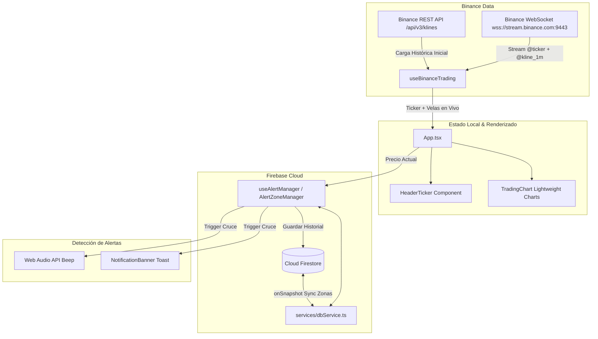

# 📊 ARPA/USDT Pro Terminal — Documentación Técnica del Proyecto

## 1. Visión General del Proyecto
**ARPA/USDT Pro Terminal** es una Progressive Web App (PWA) de alto rendimiento orientada a traders profesionales y monitoreo técnico algorítmico en tiempo real para el par **ARPA/USDT** en **Binance**.

Combina visualización gráfica fluida a 60 FPS, gestión dinámica de soportes y resistencias con interacción directa en el gráfico, alertas sonoras y visuales locales sintetizadas (Web Audio API), y sincronización en la nube en tiempo real mediante Google Cloud Firestore y Firebase Analytics.

---

## 2. Stack Tecnológico

| Capa | Tecnología | Versión | Rol / Uso |
|---|---|---|---|
| **Frontend Framework** | [React](https://react.dev/) | `^19.3.1` | Renderizado reactivo y UI interactiva |
| **Tooling & Build** | [Vite](https://vitejs.dev/) | `^8.3.4` | Servidor dev ultra-rápido y empaquetador HMR |
| **Lenguaje** | [TypeScript](https://www.typescriptlang.org/) | `~6.0.3` | Tipado estricto de eventos WS, velas y estados |
| **Estilos** | [Tailwind CSS v4](https://tailwindcss.com/) con `@tailwindcss/vite` | `^4.3.3` | Diseño estilo terminal financiero oscuro / cyber |
| **Gráficos Financieros** | [Lightweight Charts](https://tradingview.github.io/lightweight-charts/) | `^5.2.1` | Gráfico de velas y líneas de precio interactivas |
| **Tiempo Real (Cripto)** | Binance WebSocket API | Nativo | Streams `@ticker` (24h) y `@kline_<interval>` |
| **Base de Datos & Auth** | [Firebase SDK](https://firebase.google.com/) | `^13.1.0` | Cloud Firestore en tiempo real + Analytics |
| **Iconos** | [lucide-react](https://lucide.dev/) | `^1.61.0` | Iconografía técnica y de interfaz |
| **PWA** | [vite-plugin-pwa](https://vite-pwa-org.netlify.app/) | `^2.0.0` | Instalabilidad offline, manifest y service workers |
| **Hosting & CI/CD** | Netlify | - | Despliegue continuo desde GitHub con variables seguras |

---

## 3. Estructura de Directorios

```text
e:/App trading/
├── .env                       # Variables de entorno locales (NO subir a Git)
├── .env.example               # Plantilla segura de variables requeridas
├── .gitignore                 # Exclusiones de Git (node_modules, dist, .env)
├── netlify.toml               # Configuración de build y redirecciones SPA para Netlify
├── package.json               # Dependencias y scripts
├── tsconfig.json              # Configuración base de TypeScript
├── vite.config.ts             # Configuración de Vite, Tailwind v4 y VitePWA
├── public/                    # Assets estáticos, manifest e iconos PWA
└── src/
    ├── main.tsx               # Entrada React 19 y montaje en el DOM
    ├── App.tsx                # Layout principal, orquestación de datos y vistas
    ├── index.css              # Estilos base globales y directivas Tailwind v4
    ├── components/
    │   ├── HeaderTicker.tsx       # Ticker 24h en tiempo real (reloj, cambio, máximos/mínimos)
    │   ├── TradingChart.tsx       # Gráfico TradingView con velas y líneas interactivas
    │   ├── AlertZoneManager.tsx   # Panel de creación, gestión y eliminación de zonas
    │   └── NotificationBanner.tsx # Notificaciones toast de alertas activadas
    ├── hooks/
    │   ├── useBinanceTrading.ts   # Conexión WebSocket y REST a Binance (velas + ticker)
    │   └── useAlertManager.ts     # Detección de cruces de precio, cooldown y Web Audio
    ├── services/
    │   ├── firebase.ts            # Inicialización de Firebase App, Firestore y Analytics
    │   └── dbService.ts           # Funciones CRUD en Firestore para zonas y logs de alertas
    ├── types/
    │   └── trading.ts             # Interfaces de Ticker, Candle, AlertZone, AlertLog
    └── utils/
        └── audio.ts               # Síntesis Web Audio API (pitido ascendente/descendente)
```

---

## 4. Arquitectura y Flujo de Datos



### Detalle de Módulos:
1. **`useBinanceTrading.ts`**:
   - Descarga inicial vía `fetch` a `https://api.binance.com/api/v3/klines` (500 velas para contexto inmediato).
   - Conexión WebSocket nativa multiplexada o suscripciones a `arpausdt@ticker` y `arpausdt@kline_{interval}` (1m, 5m, 15m, 1h, 4h, 1d).
   - Auto-reconexión y debounce para proteger el consumo de memoria.

2. **`TradingChart.tsx`**:
   - Integración nativa con `lightweight-charts` de TradingView.
   - Creación de zonas de soporte/resistencia al hacer clic directamente sobre el gráfico.
   - Sincronización visual de líneas horizontales de zonas de precio en tiempo real.

3. **`useAlertManager.ts`**:
   - Evaluación en memoria de cada variación de precio frente a las zonas activas.
   - Cálculo de superación o caída por debajo de bandas de precio con sistema de cooldown anti-spam.
   - Sonidos generados localmente mediante osciladores Web Audio API (frecuencia alta para resistencia, baja para soporte).

4. **`dbService.ts`**:
   - Colección `zones`: almacena `id`, `price`, `type` ('SUPPORT' | 'RESISTANCE'), `label`, `createdAt`, `isActive`.
   - Colección `alerts`: historial con `zoneId`, `price`, `timestamp`, `message`.
   - Soporte en tiempo real vía `onSnapshot` para que los cambios se reflejen simultáneamente en múltiples dispositivos.

---

## 5. Configuración de Variables de Entorno

El archivo `.env` local y la consola de Netlify deben configurar las siguientes variables de Firebase:

```env
VITE_FIREBASE_API_KEY=tu_api_key
VITE_FIREBASE_AUTH_DOMAIN=tradingapp-b311e.firebaseapp.com
VITE_FIREBASE_PROJECT_ID=tradingapp-b311e
VITE_FIREBASE_STORAGE_BUCKET=tradingapp-b311e.firebasestorage.app
VITE_FIREBASE_MESSAGING_SENDER_ID=1061865255303
VITE_FIREBASE_APP_ID=tu_app_id
VITE_FIREBASE_MEASUREMENT_ID=G-Q3LBE2ZJB5
```

> **Seguridad**: El archivo `.env` está en `.gitignore`. Todas las credenciales se leen con `import.meta.env.VITE_*`.

---

## 6. Comandos del Proyecto

| Comando | Descripción |
|---|---|
| `npm run dev` | Inicia el servidor de desarrollo Vite con HMR |
| `npm run build` | Compila TypeScript (`tsc -b`) y genera el bundle de producción en `dist/` |
| `npm run preview` | Previsualiza localmente el build de producción |
| `npm run lint` | Ejecuta Oxlint para análisis estático ultrarrápido |
